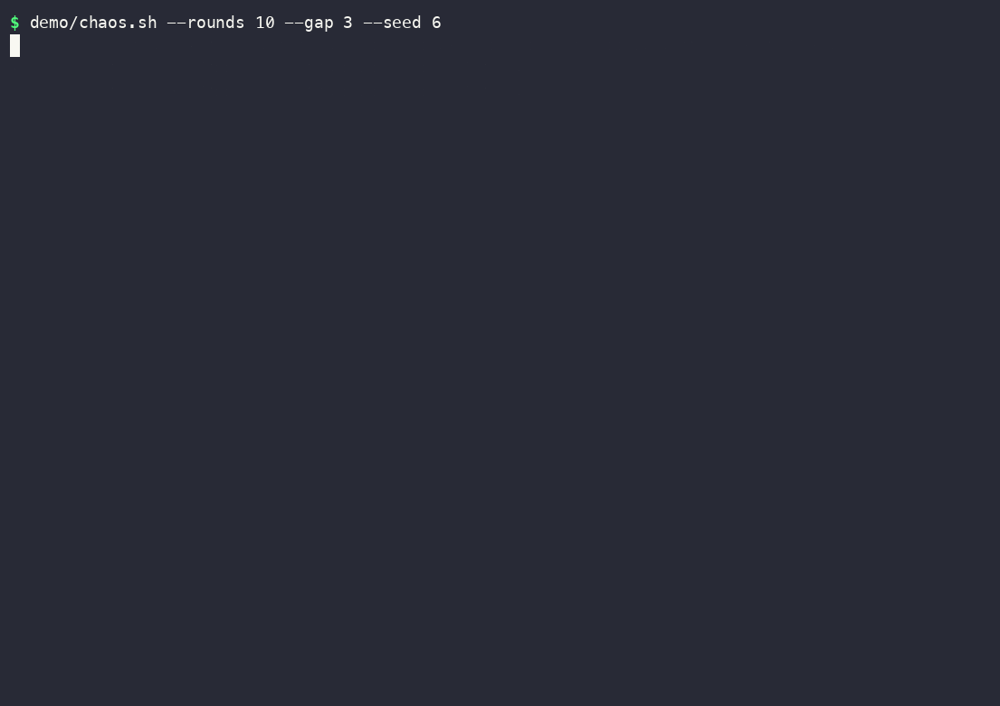
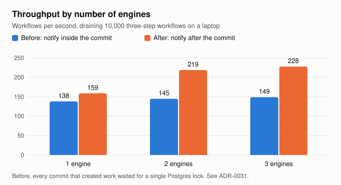

# Durastep

**A lightweight, durable workflow engine for Java.**

Write business processes as plain code, and they survive crashes, restarts and failures, completing exactly
as intended.

[](https://github.com/yanivks-pro/durastep/actions/workflows/ci.yml)
[](LICENSE)

Business processes span several steps and several systems: charge the card, reserve the stock, send the
confirmation. If the server crashes after the first step, the process is left half done, and running it again
charges the card twice. Most teams patch this with status columns, retry jobs and cleanup scripts, and every
process ends up with its own fragile version.

Durastep lets you write the whole process as ordinary Java. It records every step in Postgres and, after any
failure, carries on exactly where it stopped, without repeating the steps that already succeeded. It is a
library, not a server: one dependency and the Postgres you already run.

> **v0.6: safe to change.** Deploy new workflow code while workflows are running, check it against saved
> histories in CI first, and encrypt workflow data before it reaches the database. All on top of an engine you can
> operate and that survives chaos. It is not ready for production yet: see [Limits](#limits) and the
> [roadmap](#roadmap).



*The [demo](#quickstart) under `demo/chaos.sh`: three engines are killed and frozen while workflows keep
starting, and afterwards none is lost, no effect happened twice, and late results from frozen engines were
rejected.*

```java
public final class OrderWorkflow implements Workflow<Order, Receipt> {
  @Override
  public Receipt run(WorkflowContext ctx, Order order) {
    Shop shop = ctx.activities(Shop.class, RETRY_FIVE_TIMES);
    String charge = shop.chargeCard(order.id(), order.cents());   // charged once, even after a crash
    shop.reserveStock(order.id());
    ctx.sleep(Duration.ofDays(3));                                 // survives restarts
    shop.sendReviewRequest(order.id());
    return new Receipt(charge, ctx.now());
  }
}
```

## Proof

**Chaos:** a test runs 1,000 workflows on 3 engine processes while killing one at random with `kill -9` 100
times and freezing one 11 times. All 1,000 complete with the right result, **0 are lost and 0 effects happen
twice**, and the database passes every invariant check. It runs every night on GitHub; the latest report is
attached to each [nightly run](https://github.com/yanivks-pro/durastep/actions/workflows/nightly.yml).

```
completed 1,000 of 1,000 · lost 0 · duplicate effects 0 · kills 100 · freezes 11
zombie results rejected 110 · repeats absorbed by idempotency keys 211 · invariant violations 0
```

**Throughput:** on a laptop, with durable commits and default Postgres settings, one engine runs **159 to 198
three-step workflows a second** and three engines **228**; a step takes 16 ms at the median and 27 ms at the 99th
percentile. The [benchmarks](docs/benchmarks.md) show how this was measured, which targets are not met yet and
why, and how they found Postgres's notify lock capping three engines at 1.08 times one, and the fix that took
them to 1.43.

<picture>
  <source media="(prefers-color-scheme: dark)" srcset="docs/media/scaling-dark.svg">
  
</picture>

**Focused tests** prove each guarantee on its own, against Postgres 16 and the latest Postgres, on every commit:

- A process killed with `kill -9` in the middle of a workflow is replaced, and the card is charged once.
- A worker frozen with `kill -STOP` loses its task; when it wakes up, its result is rejected.
- A ten-second database outage in the middle of a load loses nothing and repeats nothing.
- A bug blocks a workflow with its stack trace saved; deploying the fix resumes it.
- Property tests replay hundreds of random mixes of results, timers, signals, cancellations and crashes, and
  every decision must replay identically.
- New code deployed while a workflow is sending an email lets it finish by email, while newer ones send an SMS.
- A card number and a PIN pass through an encrypted workflow and appear in neither the database nor the logs.

## Quickstart

You need only Docker:

```bash
git clone https://github.com/yanivks-pro/durastep.git && cd durastep
docker compose up -d --wait
open http://127.0.0.1:8099
```

This builds Durastep and starts Postgres, three engines, a load of orders, trips, expense claims and reports,
the read-only dashboard, Prometheus and Grafana on [http://127.0.0.1:3000](http://127.0.0.1:3000). Then break it
with `demo/chaos.sh`: the [demo guide](demo/README.md) explains its report.

To use Durastep in your own code, follow [getting started](docs/guides/getting-started.md). To run the
[examples](durastep-examples/README.md) of order processing, trip booking with a saga, and expense approval
with people in the loop, you also need Java 25.

## Features

**Write workflows as plain Java** ([guide](docs/guides/writing-workflows.md))

- Activities are ordinary interfaces; finished steps return their saved result and never run again.
- Retries with backoff, time limits per attempt and in total, and errors marked as not worth retrying.
- Every attempt of a step has the same idempotency key, such as `order-42/activity-2`, for the systems it calls.
- Durable timers that sleep for days, workflow deadlines, and `ctx.now()` and `ctx.random()` that replay
  identically.
- Signals that wait for people, a status the workflow publishes, cooperative cancellation, sagas that undo
  completed steps, and parallel steps with `Promise.allOf` and `anyOf`.

**Run them on many engines** ([architecture](docs/architecture.md))

- Every instance of your application can run an engine; they share the work through Postgres, with `SKIP LOCKED`
  claims and notifications.
- One decider per workflow, leases, heartbeats and fencing tokens, so crashed work is taken over and late
  results from frozen engines are rejected.
- Bugs and code that no longer matches a workflow's history **block** it instead of failing it; a fix resumes it.
- Graceful shutdown hands work over at once; a database outage pauses work and it resumes by itself.

**Operate them** ([guide](docs/guides/operations.md))

- A [CLI](durastep-cli/README.md) to find, inspect, retry, terminate, rerun, signal and cancel workflows, with
  an audit trail of who did what and why.
- A read-only [dashboard](durastep-dashboard/README.md) with each workflow's steps over time.
- [Micrometer metrics](docs/guides/operations.md#watching) and a Grafana dashboard, the workflow ID in every log line,
  and [one OpenTelemetry trace per workflow](durastep-opentelemetry/README.md).
- Retention of finished workflows, and limits on data and history size with a clear next step.
- A [Spring Boot starter](durastep-spring-boot-starter/README.md): two annotations and a few properties.

**Change them safely**

- `ctx.version(...)` keeps the old path for workflows that already went past a change.
- The [testkit](durastep-testkit/README.md) replays saved histories against new code in a unit test.
- Workflow data can be encrypted before it reaches the database, with key rotation
  ([security guide](docs/guides/security.md)).

## Limits

- **Only the main workflow code can wait for signals**, not code in parallel branches.
- **No Maven Central release and no published CLI image yet**: build the JARs and the image from source.
- **Replay compares which steps run and in what order, not their arguments**, both in the engine and in the
  testkit.
- **Notifications do not pass through PgBouncer in transaction mode**; behind it, engines fall back to polling
  once a second.
- **One engine runs fewer than 200 workflows a second on a laptop**, and a step takes 16 ms at the median, short
  of the targets; the [benchmarks](docs/benchmarks.md#what-limits-durastep-now) explain why and what would help.

## API stability

From 1.0, Durastep follows [semantic versioning](https://semver.org) for its public API:

- the package `io.github.yanivks_pro.durastep.api` in `durastep-core`;
- `WorkflowReplayer` and `WorkflowReplayException` in the testkit, `DurastepMetrics`, `DurastepDashboard` and
  `DurastepTracing`;
- the Spring Boot starter's `@WorkflowDefinition`, `@ActivityImplementation` and `durastep.*` properties.

Everything else, including the other packages in `durastep-core`, is internal and may change in any release; a
build rule fails if the public API ever exposes an internal type. Durastep implements `DurastepClient`,
`WorkflowHandle`, `WorkflowContext`, `ActivityContext` and `Promise` for you, and they may gain methods in minor
releases: in tests, use the [testkit](durastep-testkit/README.md) or a real engine instead of implementing them.
The database schema is upgraded by migrations when an engine starts, and running workflows carry on across
upgrades.

## Related work

Durable execution is a well-explored idea, and Durastep borrows from the systems below. It differs mainly in being
a small library for Java teams that already run Postgres.

- **[Temporal](https://temporal.io)** is the reference durable execution platform, and Durastep's model of
  workflows, activities and replay follows it closely. Temporal is a server cluster with SDKs for many languages,
  built for very large scale, with mature tooling. Durastep trades that scale and reach for having no server to
  run.
- **[Restate](https://restate.dev)** runs durable handlers through its own server and log, for many languages and
  with very low latency, and fits naturally with RPC and serverless functions.
- **[DBOS](https://www.dbos.dev)** is the closest in spirit: durable workflows as a library whose state lives in
  Postgres. It started with Python and TypeScript, and adds its own scheduling and queue features.
- **[Camunda](https://camunda.com)** models processes in BPMN, which business analysts can read and change, with
  rich tooling for human tasks. Durastep keeps processes in code.
- **[JobRunr](https://www.jobrunr.io)** runs background jobs in Java with a database as the store and a
  dashboard. It is the simpler choice for fire-and-forget or scheduled jobs; Durastep is for processes with many
  steps that must resume where they stopped.

## Non-goals

Durastep deliberately does not try to be:

- **A multi-database engine.** It relies on Postgres features and is tested on Postgres only.
- **A standalone server with SDKs for other languages.** It is a Java library.
- **A visual (BPMN) designer.** Workflows are code.
- **An exactly-once system without idempotency keys.** That is impossible in principle; Durastep gives every
  activity a stable key instead.
- **Multi-tenant or multi-region.** Those are jobs for your platform and for Postgres replication.

## Roadmap

| Milestone | What it delivers | Status |
|---|---|---|
| M0 Foundations | Build, CI, database schema, first design decisions | ✅ Done |
| M1 Core idea (v0.1) | Kill it mid-workflow, restart, and it resumes exactly | ✅ Done |
| M2 Reliability (v0.2) | Retries, timeouts and durable timers that can sleep for days | ✅ Done |
| M3 Distributed (v0.3) | Many instances, leases and fencing; chaos test with 0 lost and 0 duplicates | ✅ Done |
| M4 Interaction (v0.4) | Signals, cancellation, sagas, parallel steps and runnable examples | ✅ Done |
| M5 Operability (v0.5) | CLI, metrics and Grafana, operator commands, retention, Spring Boot starter | ✅ Done |
| M6 Safe evolution (v0.6) | Versioning, replay testing of new code, property tests, payload encryption | ✅ Done |
| M7 Showcase (v1.0) | Dashboard, tracing, benchmarks, one-command demo, recordings, complete documentation | 🚧 In progress |

## Learn more

- [Architecture](docs/architecture.md): the components, the life of a step, the data model, and how replay,
  leases and fencing work, with diagrams.
- Guides: [getting started](docs/guides/getting-started.md), [writing workflows](docs/guides/writing-workflows.md),
  including the rules workflow code must follow, [operations](docs/guides/operations.md) and
  [security](docs/guides/security.md).
- [Benchmarks](docs/benchmarks.md), the [demo](demo/README.md), and the [changelog](CHANGELOG.md).
- [Contributing](CONTRIBUTING.md), the [code of conduct](CODE_OF_CONDUCT.md) and the [security policy](SECURITY.md).
- Every significant decision is an [Architecture Decision Record](docs/adr/README.md). A few that shape the rest:
  an [embedded library](docs/adr/0002-embedded-library.md) on [Postgres only](docs/adr/0003-postgres-only.md),
  [full replay from a pure runtime](docs/adr/0009-pure-workflow-runtime.md),
  [at least once, made safe by idempotency keys](docs/adr/0010-at-least-once-with-idempotency-keys.md),
  [one writer to history](docs/adr/0012-single-writer-to-history.md),
  [leases, fencing and heartbeats](docs/adr/0018-leases-fencing-and-heartbeats.md),
  [blocked, not failed, for bugs](docs/adr/0016-blocked-versus-failed.md),
  [parallel steps on one logical thread](docs/adr/0022-parallel-steps-on-one-logical-thread.md) and
  [waking engines after the commit](docs/adr/0031-notify-after-commit.md).

### Build from source

You need **Java 25** and **Docker** (the tests run against a real Postgres in a container).

```bash
git clone https://github.com/yanivks-pro/durastep.git
cd durastep
./mvnw verify
```

`./mvnw verify` checks formatting, compiles with Error Prone, runs the unit, architecture and Postgres
integration tests, including the crash, process-kill, zombie and outage tests, and fails if line coverage drops
below 85% in any module. It also runs every example end to end, checks the CLI's output against recorded
snapshots, and starts real Spring Boot applications. `./mvnw verify -Pchaos` runs the chaos test, and `make bench`
the [benchmarks](durastep-benchmarks/README.md).

| Module | What it is |
|---|---|
| `durastep-core` | The engine, plain Java |
| `durastep-testkit` | `WorkflowReplayer` for testing new code against saved histories |
| `durastep-micrometer` | Micrometer metrics |
| `durastep-dashboard` | A read-only web dashboard |
| `durastep-opentelemetry` | One OpenTelemetry trace per workflow |
| `durastep-cli` | The command-line tool |
| `durastep-spring-boot-starter` | Spring Boot 4 integration |
| `durastep-examples` | Runnable examples and the demo; not released |
| `durastep-benchmarks` | Reproducible benchmarks; not released |

### License

Durastep is licensed under the [Apache License 2.0](LICENSE).
