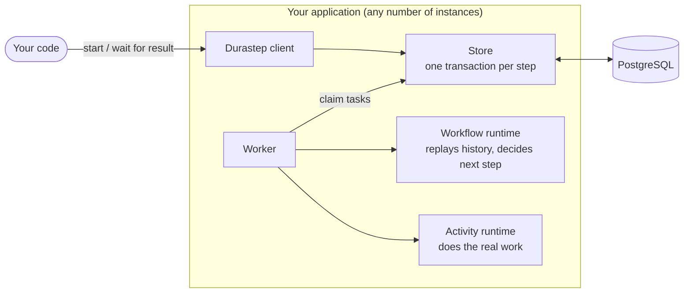

# Durastep

**A lightweight, durable workflow engine for Java.**

Write business processes as plain code, and they survive crashes, restarts and failures, completing exactly
as intended.

[](https://github.com/yanivks-pro/durastep/actions/workflows/ci.yml)
[](LICENSE)

> **v0.2: survives flaky APIs and sleeps for days.** Workflows retry failing steps, wait durably, and are
> blocked instead of lost when the code has a bug. It is not ready for production yet: see
> [Limits of v0.2](#limits-of-v02) and the [roadmap](#roadmap).

```java
public final class OrderWorkflow implements Workflow<Order, Receipt> {
  @Override
  public Receipt run(WorkflowContext ctx, Order order) {
    OrderActivities shop = ctx.activities(OrderActivities.class, RETRY_FIVE_TIMES);
    String chargeId;
    try {
      chargeId = shop.chargeCard(order.id(), order.cents());
    } catch (ActivityFailedException declined) {
      throw new WorkflowFailedException("payment failed: " + declined.failureMessage());
    }
    shop.reserveStock(order.id());
    ctx.sleep(Duration.ofDays(3));
    shop.sendReviewRequest(order.id());
    return new Receipt(chargeId, ctx.now());
  }
}
```

**Proof:**

- A separate process is killed with `kill -9` in the middle of a workflow, and a second process resumes it:
  the card is charged once, and the interrupted step runs again with the same idempotency key.
- A workflow sleeping through an engine shutdown is woken by the next engine.
- A bug blocks a workflow with its stack trace saved; deploying the fix resumes it.

These tests run in CI on every commit, against Postgres 16 and the latest Postgres.

## The problem

Business processes span several steps and several systems:

1. Charge the customer's card.
2. Reserve the stock.
3. Send the confirmation email.

If the server crashes after step 1, the process is left half-done. Running it again from the start charges the
card a second time. Most teams patch this with status columns, retry jobs and cleanup scripts, and every
process ends up with its own fragile version.

Durastep lets you write the whole process as ordinary Java code. The engine records each step durably and,
after any failure, resumes exactly where it stopped, without repeating the steps that already succeeded.

## How it works



- **Workflows are plain Java.** A workflow is a normal method that calls activities. Activities do the real
  work: API calls, database writes, emails.
- **History and replay.** Every step's result is saved to an append-only history. After a crash, another
  process replays the workflow from its history and continues with the next step.
- **Postgres is the only moving part.** Durastep is a library inside your application. There is no engine
  server: all instances coordinate through one Postgres database.

## Using it

```java
DurastepEngine engine = DurastepEngine.builder()
    .dataSource(dataSource)
    .workflow(OrderWorkflow.class, OrderWorkflow::new)
    .activities(OrderActivities.class, new ShopActivities(paymentApi))
    .build();
engine.start();

WorkflowHandle<Receipt> order = engine.client().start(OrderWorkflow.class, "order-42", input);
Receipt receipt = order.result(Duration.ofSeconds(30));
```

Give activities retries and time limits, and give a workflow a deadline:

```java
static final ActivityOptions RETRY_FIVE_TIMES = ActivityOptions.builder()
    .attemptTimeout(Duration.ofSeconds(10))
    .retryPolicy(RetryPolicy.builder()
        .maxAttempts(5)
        .initialBackoff(Duration.ofSeconds(1))
        .nonRetryable(CardDeclinedException.class)
        .build())
    .build();

client.start(OrderWorkflow.class, "order-42", input, WorkflowOptions.timeout(Duration.ofDays(7)));
```

Inside an activity, pass the idempotency key to the system you call, so a repeated call is ignored:

```java
public String chargeCard(String orderId, long cents) {
  return paymentApi.charge(orderId, cents, ActivityContext.current().idempotencyKey());
}
```

Durastep is not on Maven Central yet. Build it with `./mvnw install` and depend on
`io.github.yanivks-pro:durastep-core:0.2.0`. The engine creates its tables in a `durastep` schema on start.

## Features in v0.2

- **Workflows as plain Java**, with activities declared as ordinary interfaces.
- **Durable history and replay:** finished steps return their saved result and are never run again.
- **Start by business ID:** starting `order-42` twice returns the same workflow.
- **At-least-once activities with idempotency keys**, such as `order-42/activity-2`.
- **One transaction per step and fencing tokens:** a crash never leaves half a step, and a worker that lost its
  lease cannot write.
- **Deterministic time and randomness:** `ctx.now()`, `ctx.random()` and `ctx.randomUUID()` return the same
  values on every replay.
- **Mismatch detection:** if new code disagrees with a running workflow's history, Durastep stops instead of
  guessing.
- **Retries:** a failing activity is retried with a backoff that doubles up to a cap, with jitter, and every
  attempt uses the same idempotency key. Errors such as a declined card can be marked as not worth retrying.
- **Timeouts:** a limit per attempt, an optional limit for all attempts together, and an optional deadline for
  the whole workflow.
- **Durable timers:** `ctx.sleep(Duration.ofDays(3))` survives restarts and wakes up about half a second after
  it is due, on any engine.
- **Failures that workflow code can handle:** an activity that fails for good throws `ActivityFailedException`,
  which the workflow may catch; `WorkflowFailedException` fails the workflow on purpose.
- **BLOCKED instead of lost:** a bug, a mismatch between code and history, or an unknown workflow type leaves
  the workflow running and blocked with the error saved, and it resumes once a fix is deployed.
- **Results:** `result(timeout)` returns the value, throws `WorkflowFailedException`, or times out while the
  workflow carries on.

## Limits of v0.2

- **One worker loop per kind of work in each instance**, polling every 100 ms. Concurrency settings, `NOTIFY`
  wake-ups and multi-instance proofs come in M3.
- **No heartbeats yet.** An activity that crashes is taken over after its attempt limit plus one lease, so long
  attempt limits mean slow recovery. Heartbeats come in M3.
- **No signals, cancellation, sagas or parallel steps** (M4).
- **No CLI, metrics or Spring Boot starter yet** (M5), so blocked workflows are visible only in the database,
  and there is no Maven Central release.

## Design highlights

Every significant decision is recorded as an [Architecture Decision Record](docs/adr/README.md).

- **Embedded library, no server.** Adopting it means one dependency and one schema, not a new cluster to run.
  [ADR-0002](docs/adr/0002-embedded-library.md)
- **Postgres only.** Correctness can only be proven on the database you actually run.
  [ADR-0003](docs/adr/0003-postgres-only.md)
- **Java 25 and virtual threads.** Simple blocking code with high concurrency, and no reactive libraries.
  [ADR-0004](docs/adr/0004-java-25-virtual-threads.md)
- **One build, strict quality gates.** Error Prone, warnings as errors, enforced formatting and architecture
  rules on every build. [ADR-0005](docs/adr/0005-maven-multi-module.md)
- **Plain JDBC, at most five dependencies.** Every query is visible and reviewable.
  [ADR-0006](docs/adr/0006-plain-jdbc-minimal-dependencies.md)
- **Full replay from a pure runtime.** Replay is a function of history, tested in milliseconds without a
  database. [ADR-0008](docs/adr/0008-event-history-and-full-replay.md),
  [ADR-0009](docs/adr/0009-pure-workflow-runtime.md)
- **At least once, made safe.** Exactly-once side effects are impossible in principle; stable idempotency
  keys make repeats harmless. [ADR-0010](docs/adr/0010-at-least-once-with-idempotency-keys.md)
- **One writer to history.** A race found in design review was fixed with an inbox before any code existed.
  [ADR-0012](docs/adr/0012-single-writer-to-history.md)
- **Retries are delayed tasks.** No retry scheduler and no extra table: a failed attempt is the same task, made
  visible again later. [ADR-0015](docs/adr/0015-retries-as-delayed-tasks.md)
- **BLOCKED, not FAILED, for bugs.** A bad deployment pauses workflows instead of failing them; a fix resumes
  them. [ADR-0016](docs/adr/0016-blocked-versus-failed.md)
- **The database guards the rules.** Constraints reject invalid states, such as a second decision task for the
  same workflow or a finished workflow without a finish time. [ADR-0007](docs/adr/0007-schema-migrations-with-flyway.md)

## Build from source

You need **Java 25** and **Docker** (the tests run against a real Postgres in a container).

```bash
git clone https://github.com/yanivks-pro/durastep.git
cd durastep
./mvnw verify
```

`./mvnw verify` checks formatting, compiles with Error Prone, runs the unit, architecture, Postgres
integration, crash, process-kill, retry, timer and blocked-workflow tests, and fails if line coverage drops
below 85%.

## Roadmap

| Milestone | What it delivers | Status |
|---|---|---|
| M0 Foundations | Build, CI, database schema, first design decisions | ✅ Done |
| M1 Core idea (v0.1) | Kill it mid-workflow, restart, and it resumes exactly | ✅ Done |
| M2 Reliability (v0.2) | Retries, timeouts and durable timers that can sleep for days | ✅ Done |
| M3 Distributed (v0.3) | Many instances, leases and fencing; chaos test with 0 lost and 0 duplicates | 🚧 Next |
| M4 Interaction (v0.4) | Signals, cancellation, sagas and parallel steps | ⏳ Planned |
| M5 Operability (v0.5) | CLI, metrics and Grafana, Spring Boot starter | ⏳ Planned |
| M6 Safe evolution (v0.6) | Versioning, replay testing of new code, payload encryption | ⏳ Planned |
| M7 Showcase (v1.0) | Dashboard, tracing, benchmarks, complete documentation | ⏳ Planned |

## Non-goals

Durastep deliberately does not try to be:

- **A multi-database engine.** It relies on Postgres features and is tested on Postgres only.
- **A standalone server with SDKs for other languages.** It is a Java library.
- **A visual (BPMN) designer.** Workflows are code.
- **An exactly-once system without idempotency keys.** That is impossible in principle; Durastep gives every
  activity a stable key instead.
- **Multi-tenant or multi-region.** Those are jobs for your platform and for Postgres replication.

## License

Durastep is licensed under the [Apache License 2.0](LICENSE).
