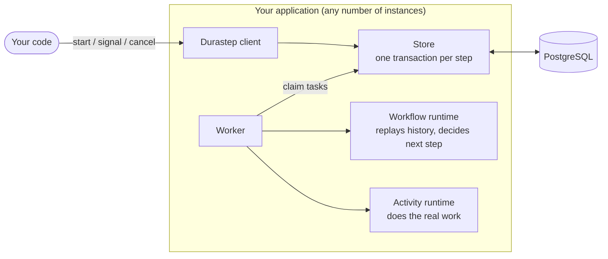

# Durastep

**A lightweight, durable workflow engine for Java.**

Write business processes as plain code, and they survive crashes, restarts and failures, completing exactly
as intended.

[](https://github.com/yanivks-pro/durastep/actions/workflows/ci.yml)
[](LICENSE)

> **🚧 Early development.** Durastep is in milestone M0 (foundations): the build, CI, database schema and
> design decisions are in place, but there is no engine yet. See the [roadmap](#roadmap).

## The problem

Business processes span several steps and several systems:

1. Charge the customer's card.
2. Reserve the stock.
3. Send the confirmation email.

If the server crashes after step 1, the process is left half-done. Running it again from the start charges the
card a second time. Most teams patch this with status columns, retry jobs and cleanup scripts, and every
process ends up with its own fragile version.

Durastep lets you write the whole process as ordinary Java code. The engine records each step durably and,
after any failure, resumes exactly where it stopped, without repeating the steps that already succeeded.

## How it will work



- **Workflows are plain Java.** A workflow is a normal method that calls activities. Activities do the real
  work: API calls, database writes, emails.
- **History and replay.** Every step's result is saved to an append-only history. After a crash, any instance
  replays the workflow from its history and continues with the next step.
- **Postgres is the only moving part.** Durastep is a library inside your application. There is no engine
  server: all instances coordinate through one Postgres database.

## Design highlights

Every significant decision is recorded as an [Architecture Decision Record](docs/adr/README.md).

- **Embedded library, no server.** Adopting it means one dependency and one schema, not a new cluster to run.
  [ADR-0002](docs/adr/0002-embedded-library.md)
- **Postgres only.** Correctness can only be proven on the database you actually run.
  [ADR-0003](docs/adr/0003-postgres-only.md)
- **Java 25 and virtual threads.** Simple blocking code with high concurrency, and no reactive libraries.
  [ADR-0004](docs/adr/0004-java-25-virtual-threads.md)
- **One build, strict quality gates.** Error Prone, warnings as errors, enforced formatting and architecture
  rules on every build. [ADR-0005](docs/adr/0005-maven-multi-module.md)
- **Plain JDBC, at most five dependencies.** Every query is visible and reviewable.
  [ADR-0006](docs/adr/0006-plain-jdbc-minimal-dependencies.md)
- **The database guards the rules.** Constraints reject invalid states, such as a second decision task for the
  same workflow or a finished workflow without a finish time. [ADR-0007](docs/adr/0007-schema-migrations-with-flyway.md)

## Build from source

You need **Java 25** and **Docker** (the tests run against a real Postgres in a container).

```bash
git clone https://github.com/yanivks-pro/durastep.git
cd durastep
./mvnw verify
```

`./mvnw verify` checks formatting, compiles with Error Prone, and runs the unit, architecture and Postgres
integration tests.

## Roadmap

| Milestone | What it delivers | Status |
|---|---|---|
| M0 Foundations | Build, CI, database schema, first design decisions | 🚧 In progress |
| M1 Core idea (v0.1) | Kill it mid-workflow, restart, and it resumes exactly | ⏳ Planned |
| M2 Reliability (v0.2) | Retries, timeouts and durable timers that can sleep for days | ⏳ Planned |
| M3 Distributed (v0.3) | Many instances, leases and fencing; chaos test with 0 lost and 0 duplicates | ⏳ Planned |
| M4 Interaction (v0.4) | Signals, cancellation, sagas and parallel steps | ⏳ Planned |
| M5 Operability (v0.5) | CLI, metrics and Grafana, Spring Boot starter | ⏳ Planned |
| M6 Safe evolution (v0.6) | Versioning, replay testing of new code, payload encryption | ⏳ Planned |
| M7 Showcase (v1.0) | Dashboard, tracing, benchmarks, complete documentation | ⏳ Planned |

## Non-goals

Durastep deliberately does not try to be:

- **A multi-database engine.** It relies on Postgres features and is tested on Postgres only.
- **A standalone server with SDKs for other languages.** It is a Java library.
- **A visual (BPMN) designer.** Workflows are code.
- **An exactly-once system without idempotency keys.** That is impossible in principle; Durastep gives every
  activity a stable key instead.
- **Multi-tenant or multi-region.** Those are jobs for your platform and for Postgres replication.

## License

Durastep is licensed under the [Apache License 2.0](LICENSE).
