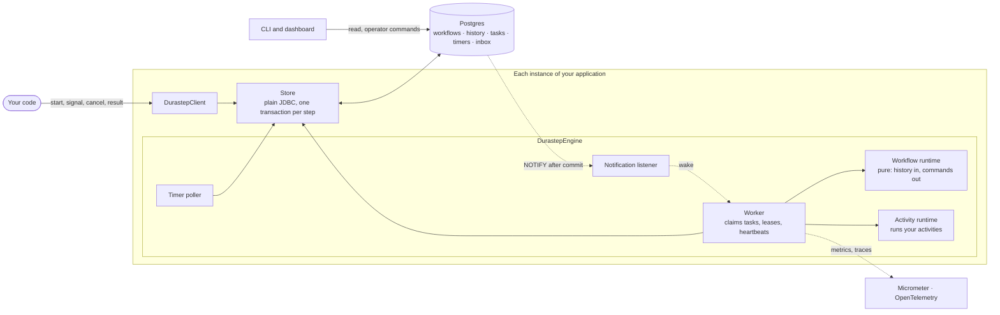
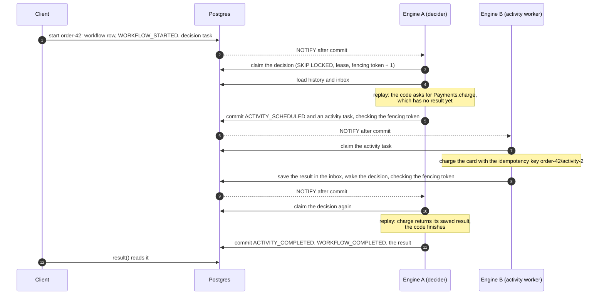
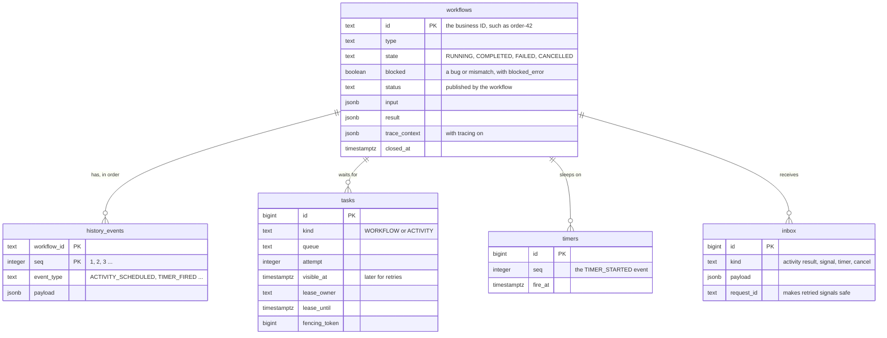
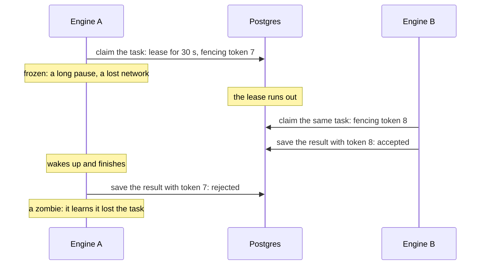

# Architecture

How Durastep is put together, what happens during one step of a workflow, how the data is laid out, and how
replay, leases and fencing keep workflows correct when engines crash or freeze. The reasons behind each choice
are in the [Architecture Decision Records](adr/README.md).

## The big picture

Durastep is a library inside your application, not a server. Every instance of the application can run an
engine, and all of them coordinate through one Postgres database: it holds the workflows and their histories, it
is the task queue, and its notifications wake idle engines.

| Component | Responsibility | Package |
|---|---|---|
| Public API | `DurastepEngine`, `DurastepClient`, `WorkflowHandle`, `WorkflowContext`, options | `api` |
| Workflow runtime | Runs workflow code against its history and returns the next commands. No database, no clock: the same history always gives the same commands | `runtime` |
| Activity runtime | Runs an activity attempt in its own virtual thread, with its time limit, heartbeats and idempotency key | `activity` |
| Worker | Claims decisions and activities when it has room, fires due timers, extends leases, saves results | `worker` |
| Store | All SQL: one transaction per step, fencing checks, notifications after commit | `store` |

The [benchmarks](benchmarks.md) show what this design does on a laptop and where its limits are.

## The life of a step

A workflow advances in decisions. A decision replays the workflow's code against its history, which tells the
code the results of the steps it already took, and the code runs until it needs something it does not have yet:
an activity's result, a timer, a signal. Here is an order that charges a card, from start to finish.

- **One transaction per step.** Each numbered write is a single transaction, so a crash leaves either the whole
  step or none of it ([ADR-0011](adr/0011-one-transaction-per-step.md)).
- **One writer to history.** Only a decision appends to a workflow's history; activity results, signals, timers
  and cancellations arrive through the inbox and are moved into the history by the next decision
  ([ADR-0012](adr/0012-single-writer-to-history.md)).
- **One decider per workflow.** A unique index allows one decision task per workflow, so a workflow's decisions
  never run in parallel, while thousands of workflows run side by side
  ([ADR-0019](adr/0019-one-decider-per-workflow.md)).
- **Woken at once, found anyway.** A notification sent after the commit wakes idle engines; if it is lost, they
  find the work at their next poll, within a second ([ADR-0017](adr/0017-postgres-as-the-task-queue.md),
  [ADR-0031](adr/0031-notify-after-commit.md)).

## The data model

Five tables in the `durastep` schema, created and upgraded by Flyway when an engine starts. Constraints reject
invalid states, such as a second decision task for one workflow
([ADR-0007](adr/0007-schema-migrations-with-flyway.md)).

- **History** is append-only and numbered. It is the single source of truth for what a workflow did.
- **Tasks** are the queue: a decision or an activity attempt waiting for an engine. A retry is the same task made
  visible again later ([ADR-0015](adr/0015-retries-as-delayed-tasks.md)).
- **Workflow data** (inputs, arguments, results, signals) can be encrypted before it reaches these tables
  ([ADR-0027](adr/0027-pluggable-payload-encryption.md)).

## Replay, leases and fencing

**Replay.** Workflow code runs again from the start at every decision. Each call to an activity, a timer or a
signal is matched with the next event in the history: if the history already has its result, the call returns
it at once; if not, the code stops there and the decision records what to do next. That is why workflow code
must be deterministic, and why Durastep blocks a workflow rather than guess when new code no longer matches its
history ([ADR-0008](adr/0008-event-history-and-full-replay.md),
[ADR-0016](adr/0016-blocked-versus-failed.md)). The [guide to writing workflows](guides/writing-workflows.md)
lists the rules.

**Leases and fencing.** An engine that claims a task gets a lease until a moment in the future and a fencing
token, a number that grows every time the task is claimed. Saving a result checks that the task still has that
token. If an engine crashes or freezes, its lease runs out and another engine claims the task with a higher
token; when the frozen one wakes up, its result no longer matches and is rejected
([ADR-0018](adr/0018-leases-fencing-and-heartbeats.md)).

**Heartbeats.** A long activity calls `heartbeat()`. Each heartbeat extends its lease, so a short heartbeat
timeout lets a crashed engine's work be taken over quickly; and a frozen engine finds out at its next heartbeat
that it lost the task, before it repeats the activity's effect.

**At least once, made safe.** An activity can still run twice: an engine can do the work and crash before it
saves the result. Every attempt of a step uses the same idempotency key, such as `order-42/activity-2`, so the
system it calls can recognise the repeat ([ADR-0010](adr/0010-at-least-once-with-idempotency-keys.md)). The
chaos test and the [demo](../demo/README.md) count repeats absorbed this way, and effects that happened twice:
always zero.
