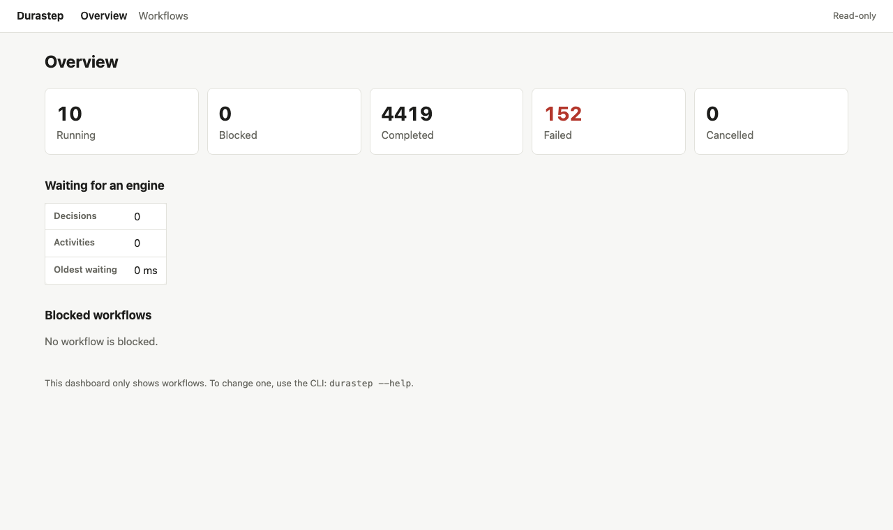
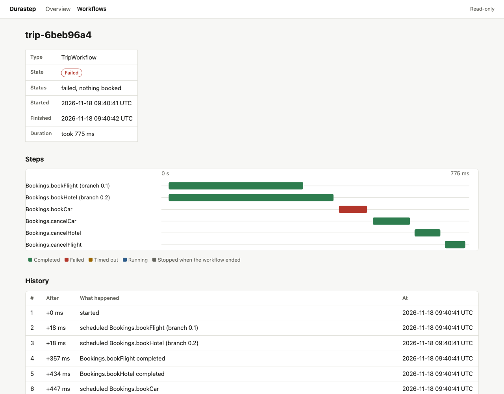

# Durastep Dashboard

A read-only web view of the workflows in a Durastep database: what runs, what is blocked, what waits, a list
to search and filter, and a page per workflow with its steps over time. It only shows; to change a workflow, use the [CLI](../durastep-cli/README.md).





## Start it from the CLI

```bash
durastep dashboard
open http://127.0.0.1:8099/
```

It uses the CLI's connection settings (`--url`, `--user`, `--password`, or the `DURASTEP_DB_*` variables) and
listens only on this machine. `--port` changes the port; `--bind 0.0.0.0` makes it reachable from other
machines, and the CLI warns that it has no login.

## Embed it

```xml
<dependency>
  <groupId>io.github.yanivks-pro</groupId>
  <artifactId>durastep-dashboard</artifactId>
  <version>1.0.0</version>
</dependency>
```

```java
try (DurastepDashboard dashboard = DurastepDashboard.start(engine.client(), 8099)) {
  log.info("Durastep dashboard at {}", dashboard.uri());
  ...
}
```

## Pages

- **Overview** (`/`): workflows by state, blocked workflows, waiting work and its age. Reloads every 5 seconds.
- **Workflows** (`/workflows`): the newest 100 workflows that match the filters: ID prefix, type, state and
  blocked. Every filter is in the address, so a filtered view can be bookmarked or shared.
- **A workflow** (`/workflows/<id>`): its summary, why it is blocked and how to retry it, a chart of its steps
  over time (completed, failed, timed out, running, or stopped when the workflow ended), and its history in plain
  words. Pages of running workflows reload every 5 seconds.

Pages never show workflow data: no inputs, arguments or results, only IDs, names, statuses, times and error
messages.

## Safety

- No login and no actions: it answers `GET` and `HEAD` only.
- Listens on `127.0.0.1` unless told otherwise.
- Escapes all text from workflows and from the address, and sends a Content Security Policy that forbids
  scripts.
- Shows a plain message when the database cannot be read; the details go to the log.

Why it is built this way: [ADR-0028](../docs/adr/0028-read-only-dashboard.md).
